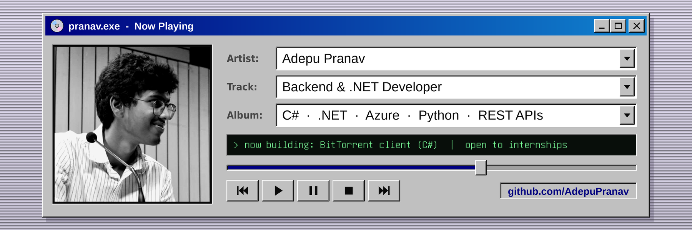

---

## About me

- 🔧 I build backend systems in **C# / .NET** and **Python**: networking, REST APIs and services that talk to each other
- 🌐 Currently building a **BitTorrent client from scratch**: bencode parsing, HTTP/UDP tracker discovery, parallel socket I/O and SHA-1 piece verification
- ☁️ **Microsoft Certified**: Azure Fundamentals · Azure AI Fundamentals
- 🏆 1st Prize @ VNR VJIET Hackathon (250+ teams) · Runner-up @ Hacktoberfest CBIT 2024 (700+ teams)
- 🎯 Looking for **backend / .NET internships**

---

## Featured projects

| Project | What it does | Stack |
|---|---|---|
| [**TorrentConsole**](https://github.com/AdepuPranav/TorrentConsole) | Peer-to-peer BitTorrent client with tracker peer discovery, piece-based parallel downloads and SHA-1 integrity checks | C#, .NET, Sockets |
| [**Rude Discord Bot**](https://github.com/AdepuPranav/CS_ChatBotDiscord_-Rude-_VERSION-) | Event-driven Discord bot backed by a locally hosted, fine-tuned Llama 3.1 model | C#, Discord.Net, Ollama |
| [**Azure Healthcare Chatbot**](LINK_TO_REPO) | Multilingual medical assistant (English, Hindi, Tamil, Telugu) with a FastAPI backend and Flutter client | Python, FastAPI, Azure AI |
| [**System Log Analyzer**](LINK_TO_REPO) | Parses server logs and flags suspicious traffic spikes with Isolation Forest anomaly detection | Python, Pandas, Scikit-learn |

---

## Experience

**Engineering Intern**, Indian Railways Institute of Signal Engineering & Telecommunications (IRISET) · *May – Jun 2025*
Built an automation tool to read and interpret railway signals across 3+ operational zones covering 100+ train routes.

---

## Tech stack

  

---

## GitHub stats

  
  

---

Outside backend work I build games in Unity. See <a href="https://github.com/AdepuPranav/Skyline-Dash">Skyline-Dash</a> 🎮

